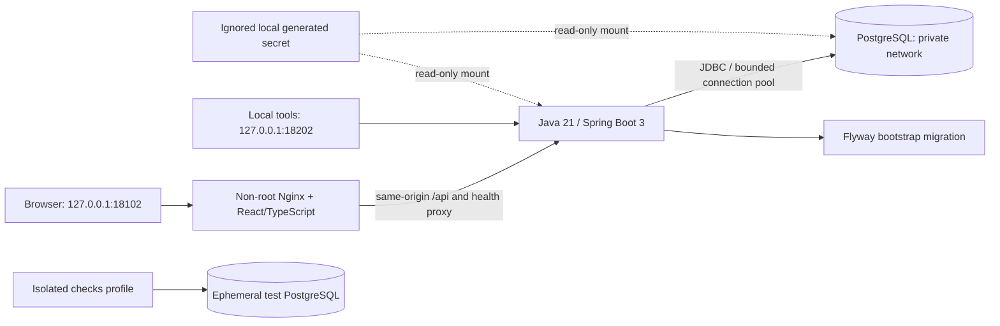
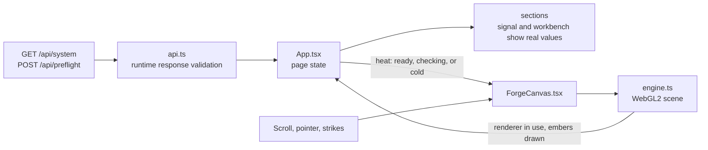

# Architecture

## Phase 1 topology

All services belong to Compose project `blacksmith`. Only web and API bind host
ports, on IPv4 loopback. The DB and API share a private, internal data network.
The API has a separate frontend network connection for the web proxy.

Runtime networks use checked, small local-lab subnets: `198.18.102.0/28` for
frontend and `198.18.102.16/28` for internal data. This avoids allocating from the
shared host's exhausted default Docker pools. Check for route overlap before
reusing these addresses on another host.

## Interfaces

| Route                            | Behavior                                                                                                        |
| -------------------------------- | --------------------------------------------------------------------------------------------------------------- |
| `GET /api/system`                | Read the bootstrap schema marker from PostgreSQL; report application, phase, execution mode, and schema version |
| `POST /api/preflight`            | Validate a synthetic label and `simulation: true`; return a non-persistent acknowledgement                      |
| `GET /actuator/health/liveness`  | Process availability; independent of database availability                                                      |
| `GET /actuator/health/readiness` | Readiness including PostgreSQL connectivity                                                                     |
| `GET /actuator/health`           | Aggregate health with no internal details exposed                                                               |

The [OpenAPI contract](../packages/contracts/openapi.yaml) is the source for
generated TypeScript types. Java contract tests assert exact response properties,
status codes, and validation semantics. The frontend also validates received
data at runtime instead of trusting a type assertion on network input.

Errors use Spring `ProblemDetail` (`application/problem+json`) with stable error
types and field-level messages. They never echo request values, SQL, credentials,
or stack traces. Database access failures on system information return 503, not
fabricated readiness. Missing future domain routes return 404.

## Persistence and migrations

Flyway owns schema history. V1 creates a single constrained `bootstrap_state`
row with schema version 1. It is synthetic infrastructure metadata, not a job.
Application startup requires a valid migration and database connection.

The production-like local DB uses a named project volume; tests use a separate
database container and ephemeral storage. Integration tests never target the
application DB. Domain tables (`jobs`, `runners`, `runner_leases`,
`cache_entries`, `schedule_decisions`) begin in Phase 2.

For this additive bootstrap migration, automatic destructive rollback is
intentionally absent. Recovery uses a forward migration. Dropping a schema or
deleting a volume requires explicit approval and is not part of startup/testing.

## Runtime and observability

- Supported container runtimes: Java 21 and Node 22; Maven in a Java 21 image.
- Spring Boot 3.5 line, with the initial patch selected from Maven metadata.
- Structured JSON console logs and OpenTelemetry-backed local trace context.
- No remote telemetry exporter, cloud account, collector, Redis, Kafka, or worker.
- JDBC connection pool bounded to four connections with finite timeouts.
- Containers have CPU, memory, PID, and log limits; web/API run non-root with
  read-only filesystems and temporary writable directories.
- Database credentials are file-mounted secrets, not embedded in an image,
  manifest, frontend bundle, or checked-in environment file.

## Front end

The page is server-independent static content from the web container. It talks
to the API only through the same-origin proxy, in two places:

- The only API-derived input to the scene is one scalar, the readiness state at
  page load. It sets the warm or cold look. No job, runner, or timing data
  reaches the renderer; every formation is fixed, seeded geometry.
- The scene is layered on top of a complete plain page. When WebGL2 is missing,
  the renderer is software, the context is lost, or the first frame reports a
  GL error, the page shows a static illustration instead, and the captions that
  describe formations are not rendered.
- The engine is loaded as a separate chunk after the first render. One shared
  animation-frame loop drives the scene and the scroll-linked effects.
- The quality governor in `quality.ts` picks a resolution, ember share, and
  bloom tier from measured frame pace. It is a display concern only.

Front-end structure, rules, and tests are described in the
[front-end notes](../apps/web/README.md).

## Future boundaries

The API will own contracts, authorization, state transitions, and persistence.
A separate worker will initially simulate execution behind an explicit interface.
An actual untrusted-code runner would require a separately reviewed hardened
isolation design; Docker Compose alone is not such a security boundary.

Redis and asynchronous events are introduced only when a demonstrated requirement
justifies them. Candidate events from the guide are `job.queued`, `runner.ready`,
`job.started`, `job.finished`, and `runner.failed`; none is emitted in Phase 1.
